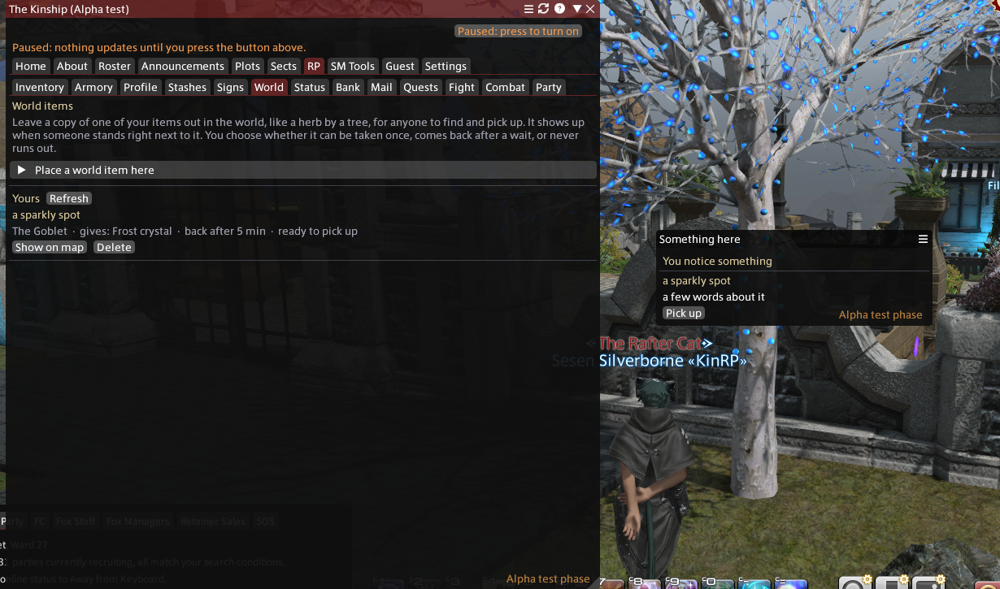
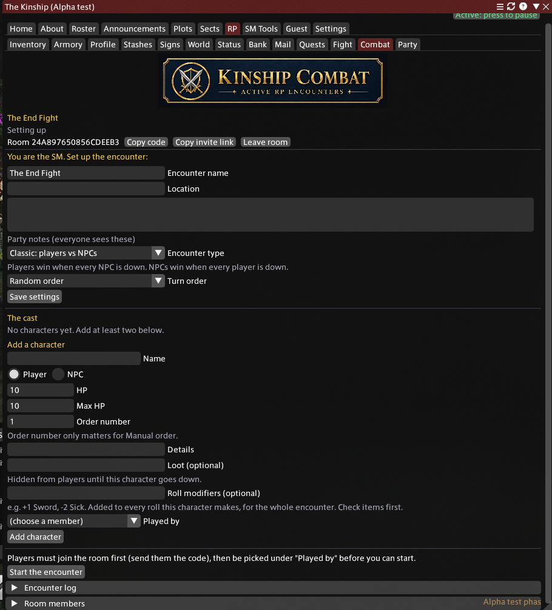
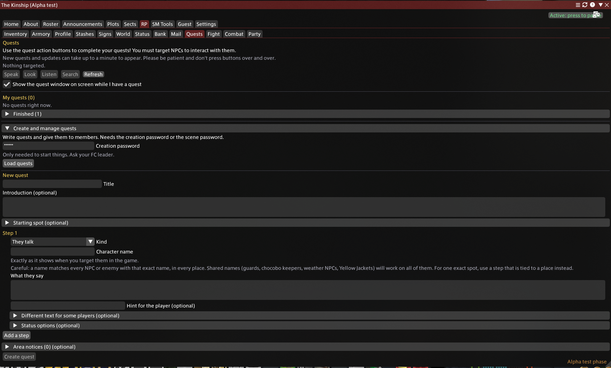

## What it looks like

Everything here is a real screenshot from in game.

### Your own inventory
Items you create, with icons picked from the game's own icons. Click to use, right-click for more.

### World items
Leave an item out in the world for someone to find. When a player stands next to it, a small "You notice something" window offers a pick up.

### Statuses
Buffs and debuffs that show on screen, with an icon you pick yourself.

### Profile cards
What other players see when they mouse over your character.

### Combat
Run an RP encounter with turns, HP and loot, all inside the plugin.

### Quests
Story writers can build quests with steps, hints and rewards. NPCs only trigger them, and the plugin only reads game state.

